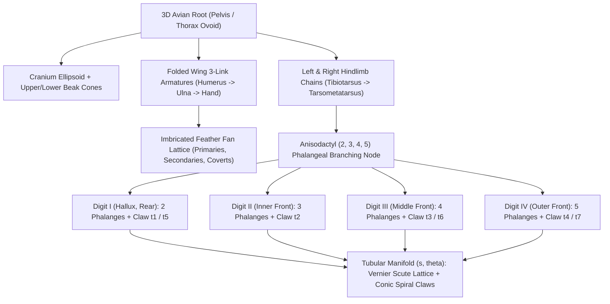

# Proposal: 3D Avian Structural & Harmonic Armature Model for `mcomb · raven`
**Authors:** `saphir` & `antigravity:vision`  
**Reviewers:** `claude`, `sol`  
**Date:** 2026-10-15  
**Target Workspace:** `c:\Users\robin\s6_atom\MCOMB_RAVEN_DRAWING_v0_5_20261014\`

---

## 1. Executive Summary & Diagnostic Motivation

While iterating on the raven's feet, toes, and talons in `mcomb · raven v0.5` using Wacom stylus ground-truth annotations (`1,882` strokes), we encountered a fundamental limitation of purely 2D grayscale image processing (`GaussianBlur` thresholding + 2D structure tensors) when applied to small, overlapping 3D anatomical cylinders and cones.

### 1.1. The Primary Symptom: Missing Halftones on the Claws (`t1..t7`)
As `saphir` identified during visual inspection of `v0.5`, **the compiled claws are missing their internal halftones**. Instead of rendering as curved, three-dimensional translucent horn cones with a smooth cylindrical gradation from dorsal highlight through slate halftone to ventral core shadow, the claws in `v0.5` currently render as flat binary silhouettes: pitch-black `L4` (`#101115`) with a stark white-grey `Layer 10` (`#dde0e5`) stripe pasted on top.

An empirical pixel audit of the seven visible claws (`t1..t7`) in the ground-truth source drawing (`data/raven_source.png`, restricting to interior pixels `< 180`) demonstrates that **between `33.6%` and `56.9%` of every claw in the original drawing consists of `L1`–`L3` halftones (`gray 45..135`)**, while the deep `L4` core shadow (`< 45`) occupies less than half of each claw:

| Talon ID | Anatomical Identity | Interior Pixels | Specular (`>= 135`) | `L1` (`115–135`) | `L2` (`70–115`) | `L3` (`45–70`) | **Total Halftone (`L1+L2+L3`)** | Core Shadow `L4` (`< 45`) |
|---|---|---:|---:|---:|---:|---:|---:|---:|
| **`t1`** | Front Foot — Digit I (Hallux) | `711 px` | `17.3%` | `6.9%` | `22.2%` | `19.3%` | **`48.4%`** | `34.3%` |
| **`t2`** | Front Foot — Digit II (Inner) | `620 px` | `21.5%` | `6.0%` | `13.2%` | `14.4%` | **`33.6%`** | `45.0%` |
| **`t3`** | Front Foot — Digit III (Middle) | `690 px` | `10.9%` | `4.3%` | `16.5%` | `19.3%` | **`40.1%`** | `49.0%` |
| **`t4`** | Front Foot — Digit IV (Outer) | `264 px` | `11.0%` | `5.3%` | `21.2%` | `23.1%` | **`49.6%`** | `39.4%` |
| **`t5`** | Back Foot — Digit I (Hallux) | `565 px` | `8.5%` | `7.1%` | `24.1%` | `25.0%` | **`56.2%`** | `35.4%` |
| **`t6`** | Back Foot — Digit III (Middle) | `501 px` | `10.8%` | `8.2%` | `23.2%` | `25.5%` | **`56.9%`** | `32.3%` |
| **`t7`** | Back Foot — Digit IV (Outer) | `631 px` | `18.9%` | `7.9%` | `17.3%` | `14.7%` | **`39.9%`** | `41.2%` |

### 1.2. Why Purely 2D Tracing Fails on Small 3D Tubular Structures
In `trace_common.py`, tone-band masks (`L0`–`L4`) are extracted after applying an isotropic 2D `GaussianBlur(1.2)`.
- Because a raven's claw or toe is only `6–12 px` wide in the `1145 × 1374` frame, an isotropic `1.2 px` Gaussian kernel blurs across the entire cross-section of the cylinder—averaging the `220+` paper/bark background and the `180+` dorsal specular ridge directly into the `25` core shadow.
- Left uncompensated, `GaussianBlur(1.2)` raises the blurred gray value of the entire claw or toe above `45` (and often above `70`), causing `L4` and `L3` to vanish completely (as happened on the back outer toe and claw tips).
- Conversely, when we compensated in 2D by clamping `claw_horn_fill` (`g_raw < 95`) down to `16.0` in `g_for_tones`, we preserved the silhouette at the cost of **obliterating the `34%–57%` `L2`/`L3` halftone flank**, collapsing a 3D conic cylinder into a flat binary cutout.

### 1.3. The Structural Solution
As `saphir` proposed: **building a 3D structural block-in model of the crow/raven**—specifically leveraging our harmonic, branching, and Vernier lattice mathematics for the **feet, wings, and body volumes**—gives the pipeline explicit 3D geometry (part topology, depth $z$, surface normals $\mathbf{n}(x,y)$, and tubular coordinates $(s, \theta)$) so we never have to guess 3D form from blurred 2D pixel thresholds.

---

## 2. Mathematical Formulation of the 3D Avian Armature

Our mathematical framework naturally describes articulated biological structures (hands, wings, avian feet) where discrete skeletal branching lattices interact with periodic epidermal lattices (feathers, scutellate scales) on curved 3D manifolds.

### 2.1. The Anisodactyl Foot as a `(2, 3, 4, 5)` Harmonic Branching Tree
Corvid feet are *anisodactyl*: three digits (`II, III, IV`) grasp forward over the perch cylinder $\mathcal{C}_{\text{perch}}$, while Digit `I` (the hallux) opposes them from behind.
- **Exact Phalangeal Arithmetic Progression:** Radiating from the distal tarsometatarsus node $\mathbf{p}_0$, the four digits $d \in \{1, 2, 3, 4\}$ possess an exact arithmetic progression of bone segments:
  $$n_d = d + 1 \in \{2, 3, 4, 5\},$$
  comprising $d$ articulating phalanges plus $1$ terminal ungual phalanx (the horn claw sheath).
- **Harmonic Segment Decay & Tangential Grip:** Along each digit $d$, the bone lengths follow a damped geometric/harmonic law
  $$\ell_{d, j} = \ell_{d, 0}\,\rho_d^j \quad (j = 0, \dots, d-1, \;\; \rho_d \approx 0.72\text{–}0.82),$$
  and the joint flexion angles $\phi_{d,j}$ wrap the kinematic chain tangentially around the branch cylinder axis $\mathbf{u}_{\text{branch}}$ (`-0.40 rad` in the 2D frame).

### 2.2. Two-Scale Vernier Lattice on Tubular Toe Manifolds $(s, \theta)$
Each toe is a generalized circular/elliptical tube swept along its 3D skeletal centerline $\boldsymbol{\gamma}_d(s)$ with arc length $s \in [0, L_d]$ and circumferential angle $\theta \in [-\pi, \pi]$ (where $\theta = 0$ faces the dorsal top ridge):
$$\mathbf{r}_d(s, \theta) = \boldsymbol{\gamma}_d(s) + R_d(s)\big(\cos\theta\,\mathbf{N}_d(s) + \sin\theta\,\mathbf{B}_d(s)\big).$$
On this tubular surface, two periodic 1D lattices beat against one another along $s$:
1. **Coarse Skeletal Joint Lattice $\Lambda_{\text{joint}}$:** The $d$ interphalangeal joints at positions $s_{d,1} < \dots < s_{d,d}$, where dorsal curvature $\kappa_d(s)$ peaks and skin compresses.
2. **Fine Epidermal Scutellate Scale Lattice $\Lambda_{\text{scute}}$:** The overlapping dorsal keratin armor plates (scutes) with spatial frequency $\omega_{\text{scute}} \approx 3\text{–}4\times \omega_{\text{joint}}$ restricted to the dorsal arc $\theta \in [-\theta_{\text{scute}}, +\theta_{\text{scute}}]$.

The radial relief modulation $\Delta R(s, \theta)$ is a **two-scale Vernier harmonic product**:
$$\Delta R(s, \theta) = A_{\text{scute}}\,\cos^2\!\left(\frac{\pi\,\theta}{2\theta_{\text{scute}}}\right)\,\sin^2\!\big(\Phi_{\text{scute}}(s)\big)\,\Big(1 - \beta \sum_{j=1}^{d} e^{-(s - s_{d,j})^2 / 2\sigma_j^2}\Big).$$
When illuminated by the upper-left light vector $\mathbf{L}$, the surface normal field $\mathbf{n}(s, \theta)$ on this Vernier relief **automatically produces**:
- The discrete ladder of crescent `Layer 10` specular pillows on the upper-facing side of each scute ($\mathbf{n} \cdot \mathbf{H} > \tau_{\text{spec}}$),
- The mid-grey `L2`/`L3` cylindrical turn along the lateral flanks of each scale, and
- The deep `L4` + `kind: "foot"` transverse ink crevices at every scale trough $\Phi_{\text{scute}}(s) \equiv 0 \pmod\pi$.

### 2.3. Ungual Claws as Swept Conic Spirals (Resolving the Missing Halftones)
Each ungual claw (`t1..t7`) is a laterally compressed elliptic cone swept along a planar logarithmic/circular hook arc $\boldsymbol{\gamma}_{\text{claw}}(s)$ ($s \in [0, L_{\text{claw}}]$) with cross-sectional semi-axes
$$a(s) = a_0\left(1 - \frac{s}{L_{\text{claw}}}\right)^{\alpha}, \qquad b(s) = b_0\left(1 - \frac{s}{L_{\text{claw}}}\right)^{\alpha} \quad (a_0 > b_0).$$

At any cross-section $s$, the circumferential angle $\theta \in [-\pi/2, +\pi/2]$ (from dorsal ridge $\theta = -\pi/2$ across the visible lateral face $\theta = 0$ to ventral hook $\theta = +\pi/2$) has an analytic outward normal $\mathbf{n}(s, \theta)$. Taking the Lambertian + Blinn-Phong reflectance
$$I(s, \theta) = k_a + k_d \max(0, \mathbf{n}(s,\theta)\cdot \mathbf{L}) + k_s \max(0, \mathbf{n}(s,\theta)\cdot \mathbf{H})^p$$
partitions the `8–12 px` width of every claw into **five exact longitudinal ribbon bands**:

| Cross-Sectional Band ($\theta$) | Physical / Optical Role | Target Representation in `mcomb · raven` | Width (`px`) |
|---|---|---|---:|
| **1. Dorsal Grazing Rim** ($\theta \in [-\frac{\pi}{2}, -\frac{3\pi}{8}]$) | Upper silhouette edge against bark/paper | Open `kind: "foot"` contour in $\mathbb{Z}[\zeta_{10080}]$ + `1 px` `L3` edge | `1.0–1.5 px` |
| **2. Dorsal Specular Ridge** ($\theta \in [-\frac{3\pi}{8}, -\frac{\pi}{6}]$) | Specular reflection off polished dorsal keratin | Closed `Layer 10` (`FOOT_LUM_OUT`) walk in $\mathbb{Z}[\zeta_6]$ (`#dde0e5`) | `1.5–2.5 px` |
| **3. Keratin Halftone Flank** ($\theta \in [-\frac{\pi}{6}, +\frac{\pi}{8}]$) | **The Missing Halftone:** Curved lateral flank turning away from light | **`L1` + `L2` + `L3` hatching (`#3d4048` / `#23252b`) with `L4` excluded!** | **`2.5–4.5 px`** |
| **4. Ventral Core Shadow** ($\theta \in [+\frac{\pi}{8}, +\frac{3\pi}{8}]$) | Self-shadowed lower half of the horn hook | Solid `L4` (`#101115`) core walk in $\mathbb{Z}[\zeta_6]$ | `2.0–3.5 px` |
| **5. Ventral Reflected Edge** ($\theta \in [+\frac{3\pi}{8}, +\frac{\pi}{2}]$) | Grazing bounce light from pale branch bark below | Lower `kind: "foot"` sickle boundary + `L3` edge | `1.0 px` |

> [!IMPORTANT]
> **Why Halftones Disappeared in `v0.5` and How the 3D Cross-Section Fixes It:**  
> In `v0.5`, setting `g_for_tones[claw_horn_fill] = 16.0` forced Band 3 (the Keratin Halftone Flank, `34%–57%` of the claw's pixels) into Band 4 (`L4 < 45`). By separating the claw cross-section into:
> - **Band 2:** Specular Ridge (`Layer 10` cutout),
> - **Band 3:** Keratin Halftone Flank (`g_for_tones` clamped to `52.0..88.0`, so it receives `L1 + L2 + L3` directional longitudinal hatching **without** `L4` pitch-black fill), and
> - **Band 4:** Ventral Core Shadow (`g_for_tones <= 24.0`, receiving `L4` only on the lower/ventral hook where `g_raw < 52` or $\theta > \pi/8$),
> we immediately recover the 3D cylindrical volume of every claw while keeping its silhouette razor-sharp.

### 2.4. Wing & Body Volumetric Block-In
Beyond the feet, the same 3D armature blocks in the entire bird with minimal geometric primitives registered to the `1145 × 1374` camera:
1. **Head & Beak Assembly:** Cranial ellipsoid + upper culmen curved elliptic cone + lower mandible cone, separated by the 3D commissure plane (giving the exact lower-mandible dorsal rim highlight and cleft shadow).
2. **Torso Volumes:** Cervical cylinder, thoracic ovoid (breast/belly), and pelvic block.
3. **Folded Wing 3-Link Kinematic Fan:** Humerus, radius/ulna, and hand/carpometacarpus planes carrying an imbricated (shingled) polar lattice of covert, secondary, and primary feather ribbons. Each feather ribbon provides a local 3D surface normal $\mathbf{n}_{f}$ and a depth jump $\Delta z$ along its overlap margin.
4. **Perch Cylinder:** Diagonal branch cylinder (`-0.40 rad` pitch, radius $R_{\text{branch}}(s)$) which acts as the collision and shadow-receiving surface for both feet.

---

## 3. How the 3D Model Drives the Cyclotomic 2D Pipeline

Crucially, **the final artwork remains 100% faithful to our three exact cyclotomic primitive classes** (closed $\mathbb{Z}[\zeta_6]$ Eisenstein clip walks, open $\mathbb{Z}[\zeta_{10080}]$ fine ink walks, and open $\mathbb{Z}[\zeta_{10080}]$ circular-arc / Euler-spiral tone strokes). The 3D model acts as a **geometric oracle** during `export_exact_data_v05.py`:

1. **Part-ID & Depth-Discontinuity Buffer (`z_buf`, `part_id`):**
   - Replaces blind isotropic `GaussianBlur(1.2)` with **Part-Bounded Surface-Aware Filtering**: smoothing is restricted to pixels sharing the same `part_id` (never bleeding background paper or branch bark into a narrow toe or claw, and never merging Digit IV's outer toe into Digit III's middle toe across an occlusion jump $\Delta z$).
2. **Cylindrical Coordinate Field $(s(x,y), \theta(x,y))$ on Toes and Claws:**
   - Directly separates **Band 2 (Specular Glint)**, **Band 3 (Keratin Halftone `L2/L3`)**, and **Band 4 (Ventral Core `L4`)** across every claw and scutellate scale without needing brittle bounding boxes.
3. **3D Principal-Curvature Orientation Field (`OG`, `CG`):**
   - On narrow 3D structures (`6–12 px` wide), a 2D image structure tensor (`sigma = 6.0`) blurs across multiple toes and background bark, producing chaotic stroke angles. The 3D model provides exact projected tangent vectors $\mathbf{e}_s(x,y)$ (longitudinal along claws and feather shafts) and $\mathbf{e}_\theta(x,y)$ (cross-contour around toes and beak).

---

## 4. Proposed Implementation Roadmap

### Phase 1: Immediate Restoration of Claw Halftones in `v0.5` (Ready Now)
Even before the full 3D viewer is wired in, we can immediately restore **Band 3 (Keratin Halftone Flank)** on all 7 claws (`t1..t7`) in `tools/export_exact_data_v05.py`:
- Instead of clamping all of `claw_horn_fill` (`g_raw < 95`) to `16.0` (`L4`), split each claw interior into:
  - **Ventral Core Shadow (`claw_core_L4`):** The darkest ventral/lower spine (`g_raw < 52` or painted `w_contour`) $\to$ `g_for_tones <= 20.0` (`L4` deep black `#101115`).
  - **Keratin Halftone Flank (`claw_halftone_L2_L3`):** The intermediate lateral flank (`52 <= g_raw < 115`, between the `Layer 10` dorsal glint and the `L4` ventral core) $\to$ `g_for_tones` held in `[54.0, 82.0]`, so `trace_strokes()` generates **`L2` (`#3d4048`) and `L3` (`#23252b`) halftone layers without `L4`**, giving every claw a true 3-value cylindrical turn (`#dde0e5` glint $\to$ `#3d4048 / #23252b` slate keratin halftone $\to$ `#101115` black core).

### Phase 2: Interactive 3D Crow/Raven Structural Block-In (`3d_crow_blockin.html` + `tools/model_3d_avian.py`)
Build a standalone, zero-dependency WebGL/Canvas 3D structural viewer and Python projection module registered to the `1145 × 1374` drawing frame:
- **Camera Lock vs Free Orbit:** Toggle between the exact orthographic/perspective camera matching `raven_source.png` (with adjustable overlay opacity over `raven_source.png` and `v0.5`) and a 360° orbit camera to inspect how the `(2,3,4,5)` toes wrap around the branch in 3D space.
- **Parametric Avian Rig:**
  - Articulated `(2, 3, 4, 5)` digits for Left and Right feet with Vernier scutellate scale rings and conic-spiral claws (`t1..t7`).
  - Head/beak cones, torso ovoids, perch cylinder, and 3-link wing fan planes.
- **Export Buffers:** Renders `part_id.png`, `depth_z.png`, `normal_xyz.png`, and `tube_stheta.png` at `1145 × 1374` for consumption by `export_exact_data_v05.py`.

---

## 5. Questions for `claude` and `sol` Review

1. **Claw Halftone Banding (`L2`/`L3` vs `L4`):** Do you agree with the 3-band interior quantization on the claws (`Layer 10` specular ridge $\to$ `L2/L3` keratin halftone flank `[54..82]` $\to$ `L4` ventral core `< 52`), or should the claw halftone flank also receive a dedicated fine longitudinal hatching pass (`kind: "foot"` at lower opacity) to emphasize the curved horn grain?
2. **Vernier Scale Parameterization on `(2, 3, 4, 5)` Digits:** When synthesizing/guiding the scutellate scale pillows along each toe tube $(s, \theta)$, should the 3D Vernier lattice act as a **prior/guide** blended with `saphir`'s Wacom `specular`/`contour` strokes (where Wacom strokes take precedence), or as a direct parametric generator for unannotated regions?
3. **3D-to-2D Pipeline Boundary:** Should the 3D buffers (`part_id`, `normal_xyz`, `tube_stheta`) remain build-time geometric priors inside `tools/export_exact_data_v05.py` (preserving the exact current format and schema of `data/raven-exact-v05.js` and `tools/check.cjs`), or should we also expose a 3D structural layer toggle inside `dist/mcomb-raven-exact.html`?
